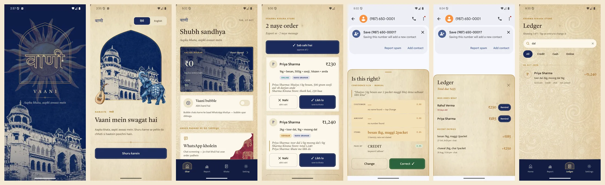
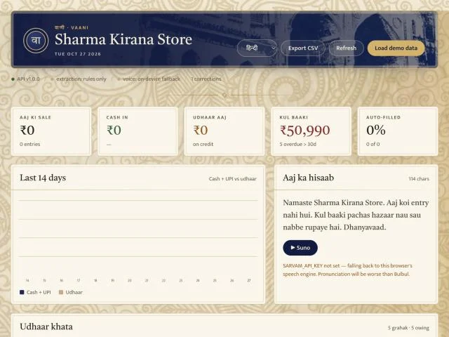

# VaaniLedger

A voice- and chat-driven *khata* (credit ledger) for small Indian shops.

Most small shops take orders on WhatsApp and keep credit in a paper notebook. VaaniLedger puts a floating assistant on top of WhatsApp. It reads a customer's message, such as *"2 kilo chawal aur 1 packet chai, dhai sau ka udhaar likh lena"*, works out the items, amount, payment mode and who owes whom, then asks the shopkeeper for one tap to confirm.

It needs no WhatsApp Business API, and the core works offline on the phone.





## What it does

- **Reads orders from chats:** reads messages from the screen, notifications or a WhatsApp export, in Hinglish, English and Devanagari.
- **Understands how shops talk:** handles Hindi number words like *dhai sau* (250), credit and payments, orders sent in pieces, and synonyms like *chini* and *sugar*.
- **Asks only about what it's unsure of:** each field gets its own confidence, so a sure amount with a guessed item asks only about the item.
- **Keeps the khata:** customers, balances and overdue credit, with payments settling the oldest debt first.
- **Sends reminders:** builds WhatsApp and UPI payment links for customers who owe money.
- **Speaks a summary:** reads the day's totals aloud in Hindi, English or Marathi.
- **Syncs a dashboard:** an optional server on the shop's Wi-Fi shows the same khata in a browser, paired with a six-digit code.

## How it's built

| Part | Technology | Role |
| --- | --- | --- |
| Android app | Kotlin, Room, WorkManager | Floating bubble, chat capture, on-device engine, ledger |
| Extraction engine | Python, plus a Kotlin port | Rules for numbers, items, amounts, mode and direction |
| Server | FastAPI, SQLite | Sync, summaries, speech, API in `docs/api.yaml` |
| Dashboard | One HTML file, hand-written SVG charts | No build step, served at `/` |
| Optional stage 2 | Claude, Sarvam TTS | Model fallback for hard messages, and spoken summaries |

The Python and Kotlin engines must agree: a parity test replays all 142 benchmark chats through the Kotlin engine and requires identical answers.

## Accuracy

These numbers come from the rules engine with no model, measured on 142 WhatsApp threads across six kinds of shop. Some threads are chatter, questions, complaints or cancellations that should book nothing.

The threads are split so that some were never used for tuning. The second test set was written before its round of fixes, scored once, then scored again after the fixes, without its failures being read in between.

| Fresh held-out set (40 threads, 29 orders) | Before | After |
| --- | --- | --- |
| Orders invented (precision) | 93.5% | **100%** |
| Order completely right: items, quantities, total and mode | 82.8% | **86.2%** |

The first held-out set went from 8.6% to 80.0% of orders completely right. The second set was written afterwards and started at 82.8%, which suggests the first round's gains carry over to new messages rather than fitting the tuned examples.

**What these numbers don't show:**

- The 122 single-message cases score 100% because they were written and then fixed against. They're now a regression suite, not a measure of accuracy.
- All test chats were written by the team, not collected from real shopkeepers.
- The Claude stage is wired in but unmeasured, because it needs API credentials.

## Try it

**Run the tests:**

```bash
cd backend && python3 -m unittest discover -s tests -t .
```

**Score the engine on whole chats.** Add `--verbose` to see every miss:

```bash
cd backend && python3 -m eval.chats --set all
```

**Start the server and dashboard,** then open <http://localhost:8000>, or <http://localhost:8000/docs> for the API:

```bash
./run.sh serve
```

**Extract one message:**

```bash
curl -s localhost:8000/extract -H 'content-type: application/json' -d '{"text":"2 kilo chawal aur 1 packet chai, dhai sau ka udhaar likh lena","sender_name":"Rahul Verma","known_customers":["Rahul Verma","Priya Sharma"]}' | python3 -m json.tool
```

**Build the Android app.** This needs Android Studio's JDK and SDK:

```bash
cd android && ./build-and-run.sh
```

## Design choices

1. **The engine works without a model.** Rules handle most messages offline. If a model call fails, the engine falls back to rules instead of losing the entry, because a shop counter often has no signal.
2. **Duplicates are caught with a watermark, not a model.** A cursor keeps the last processed timestamp and hashes of recent messages. A model that is right 99% of the time would still put duplicate money in a khata one time in a hundred.
3. **Confidence is per field.** One blended score would hide the common case, where the amount is certain and only the item is a guess.
4. **The voice never makes up a number.** Spoken summaries fill fixed templates with totals from the ledger, so ₹4,240 is never paraphrased as "about four thousand".

## Bugs worth knowing about

Each of these would have put a wrong number in someone's ledger, and each now has a regression test.

- **Hindi words that are also verbs:** *do* means 2 but usually means "send", so *"chai bhej do, dhai sau"* became 450 instead of 250. *Diya* and *daal* had the same problem.
- **A quantity read as a price:** *"2 kilo chawal bhej do"* booked ₹2. A missing amount can be fixed later, but a wrong one can't.
- **`\b` fails on Devanagari:** Python's regex treats vowel signs (matras) as outside a word, so most Hindi word-boundary patterns silently never matched.
- **Phone numbers read as bills:** a captured "Save (987) 650-0001?" banner became a ₹987 bill. Phone numbers are now removed before any number is read.
- **Thousands commas:** "1,250" was read as 250.
- **Overdue credit:** taking the oldest credit date outright aged balances from debts already paid, so every regular customer looked overdue. Payments now settle the oldest debt first, on both the phone and the server.

## Repository layout

```
backend/     FastAPI server, Python extraction engine, evals, tests
android/     Kotlin app: overlay, capture, on-device engine, Room, sync
dashboard/   single-file web dashboard
docs/        API contract, status notes, technical report, screenshots
run.sh       starts the server and dashboard
```

More detail is in [docs/STATUS.md](docs/STATUS.md) and the [technical report](docs/VaaniLedger-Technical-Report.pdf).
